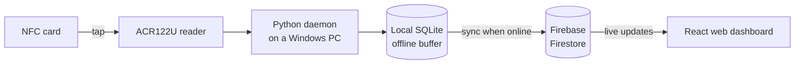

# SSC NFC Attendance System

Tap-to-log attendance for student council officers. Officers tap their NFC ID
card on a USB reader, and their attendance shows up live on a web dashboard.

The reader keeps working when the internet drops: every tap is saved on the
local PC first and uploaded to the cloud as soon as the connection returns.

---

## Features

- **One-tap clock-in.** Officers tap their card once when they arrive.
- **Supervised clock-out.** A dedicated "clock-out tag" opens a 15-second
  window in which the next officer tap clocks that officer out, so a stray
  tap can't end someone's shift by accident.
- **Automatic end of day.** Anyone still clocked in at 9 PM is clocked out
  automatically and flagged as auto-closed.
- **Works offline.** Taps are buffered in a local SQLite database and synced
  to Firebase when the connection is back.
- **Live kiosk.** A real-time board of who is on duty today.
- **Officer roster.** Officer cards with photos, grouped by council position.
  Admins enrol new officers by tapping their card on the reader.
- **Attendance calendar.** A monthly view of each day's attendance, with
  per-day schedules (regular day, no classes, and so on) and the officers
  required to be present.
- **Semesters.** Each semester keeps a snapshot of that term's roster, so past
  records stay accurate after officers change.
- **Reports.** Export attendance to CSV or a multi-sheet Excel workbook.

## How it works



1. A small Python program runs in the background on the PC the reader is
   plugged into. It reads each card's ID and decides whether the tap is a
   clock-in or a clock-out.
2. The tap is written to a local SQLite database immediately, so nothing is
   lost if the network is down.
3. A background thread uploads pending taps to Firebase Firestore.
4. The web dashboard listens to Firestore and updates as soon as new taps
   arrive.

## Dashboard access

The supplied Firebase rules require an admin account for all attendance data.
Visitors are redirected to sign in. Admins can view the kiosk, manage officers,
export and edit attendance, configure schedules, and manage semesters.

Officer names, photos, card IDs and attendance history should stay private when
publishing the source code. A public kiosk would need a separate view containing
only approved information. Apply the rules in the [developer guide](DEV_SETUP.md)
in Firebase; repository changes alone do not update the live service.

## Built with

| Part | Technology |
|---|---|
| Card reader | ACS ACR122U (USB, PC/SC) |
| Background daemon | Python, pyscard, SQLite, `firebase-admin`, `schedule` |
| Database & auth | Firebase Firestore, Authentication, Storage |
| Web dashboard | React 18, Vite, Tailwind CSS, React Router, SheetJS |

## Repository layout

```
ssc-ootd/
├── nfc-daemon-python/          # Background program that reads the NFC reader
├── attendance-dashboard-web/   # React web dashboard
├── setup-windows.bat           # One-click developer setup (Windows)
├── dev-web.bat                 # Start the dashboard locally
├── dev-daemon.bat              # Start the daemon with a visible console
└── DEV_SETUP.md                # Developer guide
```

## Running it yourself

You'll need your own Firebase project, Node.js 22.12+ or 24+, Python 3.10+, and an
ACR122U reader. The dashboard also runs without a reader.

See **[DEV_SETUP.md](DEV_SETUP.md)** for full setup instructions.

> [!NOTE]
> Use your own Firebase project. Keep service-account keys, local configuration,
> databases and attendance exports out of Git. Firebase web configuration is
> visible in the browser; deployed security rules protect the data.
> Storage photo uploads require Blaze billing and are optional on Spark.
