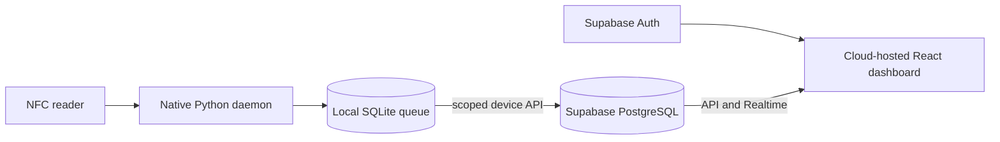

# SSC NFC Attendance System

Officers tap their NFC cards on the SSC PC. A native Python reader records
attendance in SQLite and uploads it to Supabase PostgreSQL. The React dashboard
is hosted separately so admins and approved officers can view uploaded records
even when the reader PC is off.

## Start the migration

Follow **[SUPABASE_SETUP.md](docs/SUPABASE_SETUP.md)**, starting with a new Supabase
Free project. Firebase development data is not imported. No Docker is required.
The code is migrated; cloud schema, accounts, credentials, and website hosting
must still be configured using the guide.

Already running Supabase? Follow [the dashboard upgrade guide](docs/DASHBOARD_UPGRADE.md)
for the new semester/calendar migration before starting the updated code.

## Features

- NFC clock-in and supervised clock-out through a dedicated clock-out tag.
- SQLite offline queue with persistent event UUIDs for duplicate-safe retries.
- Persistent officer cache for known-card attendance after an offline restart.
- Cloud sign-in: admins manage records; approved officers have viewing access.
- Live attendance, officer roster, monthly calendar, schedules, and semesters.
- [Live Kiosk](docs/LIVE_KIOSK.md) shows unlinked NFC cards by UID until their owner is identified.
- Compressed officer photos stored directly as PostgreSQL binary data.
- Archived roster snapshots retain their original photo references.
- CSV and Excel exports with assigned/voluntary attendance calculations.
- Admin [CSV imports](docs/ATTENDANCE_IMPORT.md) with name review, duplicate checks, and audited batches.
- Officer profiles with optional NFC cards; link a card to imported history later.
- Unknown-card attendance stays pending until an admin links it to an officer.
- Semester weekly assignments and a day-type calendar, managed by admins.
- Explicit [whole-semester schedule application](docs/SCHEDULE_HISTORY.md) for historical attendance.
- Admin [attendance analytics](docs/ANALYTICS.md) with trends, officer comparisons, and CSV exports.
- Audited attendance corrections with reader-state reconciliation.
- School-time 9 PM auto-close with missed-cutoff recovery on reconnect.

## Architecture

The SSC PC only needs the reader program, its local queue, and the NFC driver.
It does not host PostgreSQL or the website. Pending offline events become
visible to other devices after the reader reconnects and uploads them.

## Repository

| Location | Purpose |
|---|---|
| `attendance-dashboard-web/` | React, Vite, Tailwind, Supabase JavaScript client |
| `nfc-daemon-python/` | NFC reader, state machine, SQLite queue, scoped HTTPS RPCs |
| `docs/` | Developer and Supabase setup guides |
| `supabase/migrations/` | PostgreSQL schema, role permissions, device RPCs, Realtime |
| `scripts/register_reader.py` | Generate device credentials and registration SQL |
| `scripts/test_database.py` | Disposable PostgreSQL integration test harness |
| `setup-windows.bat` | Personal development PC dependencies |
| `setup-reader.bat` | Reader-only dependencies for the SSC PC |

See [DEV_SETUP.md](docs/DEV_SETUP.md) for developer commands and
[SUPABASE_SETUP.md](docs/SUPABASE_SETUP.md) for cloud provisioning, account roles,
reader installation, website hosting, backups, and remaining enhancements.

Configuration files, reader tokens, databases, and attendance exports stay out
of Git. The dashboard uses a public/publishable key plus row-level security;
never place a database password or service-role key in browser configuration.
